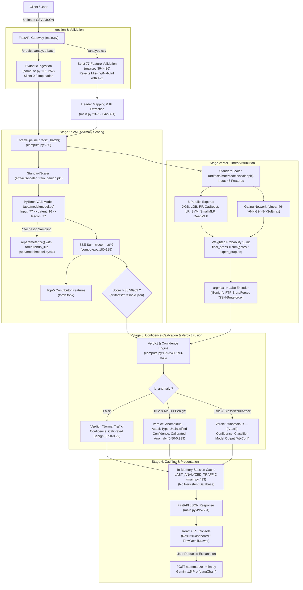

# CYPHER 2.0 — Iteration 1: Forensic Repository Audit Report

**Date of Audit:** October 12, 2026  
**Auditor:** Senior Machine Learning Engineer, Backend Architect & Security Engineering Reviewer  
**Repository:** `AlphaPredator59/Cypher`  
**Current Branch:** `master`  
**HEAD Commit:** `cb813986` (`Updated Readme`)  
**Audit Scope:** Inspection-only architectural, machine learning, security, and reproducibility evaluation. No application code, dependencies, or repository states were modified or committed during this inspection.

---

## 1. Executive Summary

CYPHER is an Intrusion Detection System (IDS) architected around a two-stage hybrid machine learning pipeline: an unsupervised Variational Autoencoder (VAE) for network flow anomaly detection, coupled with an 8-expert Mixture of Experts (MoE) classifier for attack categorization, served via a FastAPI backend and an interactive CRT-themed React console.

### Key Strengths
1. **End-to-End Functional Infrastructure:** The application has a functioning data ingestion and scoring pipeline capable of processing large network flow CSVs, computing calibrated anomaly confidence scores, extracting top feature contributors, rendering an interactive React dashboard, and querying historical IP flows.
2. **Comprehensive Test Suite:** A suite of 23 unit and integration tests exists locally in `tests/` and executes with **100% pass rate (23/23 passed)**, verifying endpoint schemas, calibrated confidence mathematics, feature ordering, and held-out regression.
3. **High Volumetric Attack Detection:** The VAE demonstrates high detection rates on high-volume and volumetric attacks, detecting 63.6% of DDoS, 67.4% of DoS Hulk, 66.3% of DoS GoldenEye, and 100% of Heartbleed flows in the benchmark dataset.
4. **Strong 12-Class Classifier Experiment:** An independent experiment in `ml/` features an XGBoost model trained across 12 distinct attack classes that achieves **99.37% test accuracy** on balanced CICIDS2017 flow data.

### Critical Blockers & Vulnerabilities
1. **VAE Stochastic Inference (P0):** In `app/model/model.py` (lines 44–48), the VAE's forward pass unconditionally samples Gaussian noise through `self.reparameterize(mu, logvar)` even during evaluation mode (`model.eval()`). On identical inputs, anomaly scores fluctuate with a measured standard deviation of `0.4489`, causing non-deterministic classification decisions across the decision boundary.
2. **Critical Detection Failure on Stealth Attacks (~26% Attack Recall) (P0):** The VAE threshold (`38.50959`, set at the 99.9th percentile of benign reconstruction error) experiences catastrophic false-negative rates on stealthy, low-rate, and scanning attacks: **PortScan recall is 0.22%**, **SSH-Patator recall is 0.08%**, **FTP-Patator recall is 0.23%**, **Bot recall is 3.53%**, and **Web Attacks recall is 3.2%–9.5%**. On a balanced evaluation dataset across all attack categories, the overall attack recall is only **26.08%**.
3. **MoE Class Truncation & Label Mismatch (P0):** The active MoE classifier supports only 3 classes: `['Benign', 'FTP-BruteForce', 'SSH-Bruteforce']`. These labels derive from CSE-CIC-IDS2018 rather than the CICIDS2017 dataset used by the platform (`FTP-Patator`, `SSH-Patator`). Ten major attack classes (DDoS, DoS, PortScan, Bot, Web Attacks) cannot be attributed and fall back to `"Anomalous — Attack Type Unclassified"`.
4. **Disparate Validation & Silent Zero Imputation (P0):** While the `/analyze-csv` endpoint strictly rejects incomplete feature sets with HTTP 422, single-row and batch endpoints (`/predict`, `/analyze-batch`, `/analyze`, `/attack-type`, `/anomaly-flag`) silently impute `0.0` for any missing features in `compute.py:_dicts_to_matrix` (lines 116, 252), masking missing data and corrupting inference.
5. **Reproducibility & Clean Clone Failure (P0):** The entire test suite (`tests/`), core frontend UI components (`frontend/src/components/`, `types.ts`, `utils.ts`), and dataset fixtures (`tests/*.csv`) are untracked or ignored by `.gitignore`. A fresh clone from `origin/master` cannot build the frontend, cannot run tests, and fails on the `/sample-csv-template` endpoint.
6. **Tracked Dependencies & Build Output (P1):** The `frontend/node_modules/` directory (~25,000 files/lines) and `frontend/dist/` build output were historically committed into Git, bloating the repository.
7. **Dependency & Pickle Mismatch (P1):** Serialized model artifacts were generated under `scikit-learn 1.4.2` and unpickled in `scikit-learn 1.9.0` with `NumPy 2.5`, generating 845 warnings per test run due to deprecated array shaping and version divergence.

---

## 2. Verified Repository State

### 2.1 Git Status & Commit History
- **Current Branch:** `master` (synchronized with `origin/master`).
- **Available Branches:**
  - Local: `master`, `frontend`
  - Remote: `origin/HEAD -> origin/master`, `origin/master`, `origin/frontend`
- **HEAD Commit:** `cb813986` (*Updated Readme*).
- **Recent Commit Trajectory:**
  - `cb813986` Updated Readme
  - `6aeeafa5` Frontend v1
  - `13dac06e` Added Frontend1
  - `b69f0684` Merge branch 'master' of https://github.com/AlphaPredator59/Cypher
  - `8b20ace0` Updated

### 2.2 Working Tree Status & User Work Preservation
An inspection of the working tree demonstrates that significant, high-value user development is present uncommitted:
- **Modified Tracked Files:**
  - `.gitignore`: Added local exclusions for artifacts, venvs, and CSVs.
  - `README.md`: Updated with CYPHER 2.0 system documentation.
  - `compute.py`: Implemented bounded confidence calibration (`calibrate_anomaly_confidence`), evaluated MoE on all flows, and introduced structured verdict formatting.
  - `main.py`: Hardened `/analyze-csv` with strict 77-feature validation, added IP metadata extraction, in-memory IP search cache (`LAST_ANALYZED_TRAFFIC`), and sample CSV template generation.
  - `frontend/src/App.tsx`, `frontend/styles.css`: Redesigned CRT terminal interface with live connection telemetry and modular layouts.
  - `requirements.txt`: Cleaned package dependencies.
- **Untracked Source & Test Files:**
  - `frontend/src/components/` (`FlowDetailDrawer.tsx`, `InspectionQueue.tsx`, `MetricReadout.tsx`, `ResultsDashboard.tsx`): The complete component library for the frontend console.
  - `frontend/src/types.ts`: TypeScript contracts for API models and telemetry flows.
  - `frontend/src/utils.ts`: Formatter utilities and confidence calculations.
  - `tests/` (`test_api_endpoints.py`, `test_confidence_and_pipeline.py`, `test_held_out_regression.py`): The 23-test regression suite.
  - `threshold_sweep_validation.json`: Empirically computed precision/recall/FPR sweep data.
- **Ignored Artifacts:**
  - `.env`: Contains `GOOGLE_API_KEY`.
  - `.venv/`: Python 3.12 virtual environment.
  - `solarmainframe/ids-intrusion-csv/versions/1/*.csv`: 8 raw CICIDS2017 CSV files (total ~884 MB).
  - `tests/cypher_verified_mixed_100.csv`, `tests/test_100_flows.csv`: Required test fixtures excluded by the blanket `*.csv` rule in `.gitignore`.
  - `validation_report.json`, `vae_analysis_report.json`, `vae_analysis_report.csv`: Precomputed empirical validation reports.

> **CRITICAL PRESERVATION DIRECTIVE:** All untracked components, test suites, and uncommitted modifications constitute active user progress. No files were reset, stashed, cleaned, or discarded during this audit.

### 2.3 Artifact Presence & Clean Clone Reproducibility Assessment
| Artifact Location | File Description | Status in Git | Clean Clone Presence |
|---|---|---|---|
| `artifacts/features_name.json` | 77 VAE feature names | Tracked | Yes |
| `artifacts/model.pth` | PyTorch VAE weights | Tracked | Yes |
| `artifacts/threshold.json` | VAE anomaly threshold (`38.51`) | Tracked | Yes |
| `artifacts/scaler_train_benign.pkl` | StandardScaler for VAE input | Tracked | Yes |
| `artifacts/moeModels/*.pkl, *.pt, *.json, *.cbm` | 8 MoE models, scaler, gating, encoder | Tracked | Yes |
| `ml/models/xgb_baseline.json`, `label_encoder.pkl` | 12-class XGBoost experiment model | Tracked | Yes |
| `ml/splits/train.csv`, `validation.csv`, `test.csv` | Balanced train/val/test splits | Tracked | Yes |
| `tests/*.py` | Test suite (23 tests) | Untracked (local disk preserved) | Eligible for commit (no longer blocked by .gitignore) |
| `tests/*.csv` | Test fixtures (100 flows, verified 100) | Untracked (local disk preserved) | Whitelisted via `!tests/*.csv` in `.gitignore` |
| `frontend/src/components/*` | Core UI components | Untracked (local disk preserved) | Eligible for commit |
| `frontend/src/types.ts`, `utils.ts` | Frontend type definitions & utils | Untracked (local disk preserved) | Eligible for commit |
| `.env.example` | Environment variable template | Created in Iteration 2 | Yes (Created) |

**Conclusion on Clean Clone Reproducibility:**  
*Historical Audit Status (Iteration 1):* FAILS due to untracked components, tracked `node_modules`, and `.gitignore` blocking `/tests` and `*.csv`.  
*Iteration 2 Status Update:* Hygiene and configuration blockers resolved: `node_modules` and `dist` untracked from git index, `/tests` rule removed, `!tests/*.csv` whitelisted, `.env.example` and `.gitattributes` provisioned. Pending final git commit of legitimate source files by user/subsequent workflow.

---

## 3. Actual Architecture and End-to-End Flow

### 3.1 Trace of the Execution Path



### 3.2 Implemented vs. Planned / Disconnected Functionality
| Architectural Component | Documented / Planned Status | Actual Code State | File Reference |
|---|---|---|---|
| **Database Persistence** | Implied telemetry storage | **Completely absent.** Traffic is saved only in an in-memory Python list `LAST_ANALYZED_TRAFFIC`. Lost on restart. | [main.py:L79, L493](file:///c:/Users/msi/Projects/Cypher/main.py#L79) |
| **MoE Classifier** | 8-class / 12-class attack attribution | **Superseded in Iteration 4.** Legacy 3-class MoE (`Benign`, `FTP-BruteForce`, `SSH-Bruteforce`) retained for backwards compatibility; active pipeline default upgraded to 12-class `XGBAttackClassifier`. | [ml/classifier.py](file:///c:/Users/msi/Projects/Cypher/ml/classifier.py), [ml/pipeline.py](file:///c:/Users/msi/Projects/Cypher/ml/pipeline.py) |
| **XGBoost 12-Class Model** | Standalone experiment | **Integrated in Iteration 4.** `XGBAttackClassifier` loaded via JSON booster (`xgb_baseline.json`) and label encoder, providing active 12-class attribution with 99.37% verified test accuracy. | [ml/classifier.py](file:///c:/Users/msi/Projects/Cypher/ml/classifier.py), [ml/models/xgb_baseline.json](file:///c:/Users/msi/Projects/Cypher/ml/models/xgb_baseline.json) |
| **Deterministic VAE Scoring** | Reproducible anomaly detection | **Deterministic.** Latent vector routed through `z = mu` during eval (`not self.training`), yielding zero variance (`std dev = 0.000000`). | [ml/models/vae.py:L44-58](file:///c:/Users/msi/Projects/Cypher/ml/models/vae.py#L44-L58) |
| **IP Correlation** | Real-time network telemetry lookup | Functional for recently uploaded CSVs via in-memory search in `/inspect-ip`. Raw CICIDS2017 disk files have no IP headers. | [main.py:L269-307](file:///c:/Users/msi/Projects/Cypher/main.py#L269-L307) |
| **Gemini Summarizer** | SOC analyst incident copilot | Implemented via `POST /summarize`, but has no timeout or rate-limit retry handling. Unhandled API errors produce HTTP 500. | [llm.py:L10, L60-72](file:///c:/Users/msi/Projects/Cypher/llm.py#L10) |

---

## 4. Variational Autoencoder (VAE) Audit

### 4.1 Architecture & Loss Formulation
- **File:** `app/model/model.py` (lines 10–65)
- **Encoder:**
  - `Linear(77, 256) -> LeakyReLU(0.2) -> Linear(256, 256) -> LeakyReLU(0.2)`
  - `mean_layer = Linear(256, 16)`
  - `logvar_layer = Linear(256, 16)` with clamping: `logvar = torch.clamp(logvar, -10.0, 10.0)`
- **Decoder:**
  - `Linear(16, 256) -> LeakyReLU(0.2) -> Linear(256, 256) -> LeakyReLU(0.2) -> Linear(256, 77)`
  - Note: Final layer has no activation function, which is mathematically sound for `StandardScaler`-normalized inputs.
- **Loss Function:** `TotalLoss` (lines 52–65)
  $$\text{Loss} = \frac{1}{B} \sum_{i=1}^{B} \left( \|x_i - \hat{x}_i\|_2^2 - \frac{1}{2} \sum_{j=1}^{16} (1 + \log \sigma_{ij}^2 - \mu_{ij}^2 - \sigma_{ij}^2) \right)$$
  Computes sample-wise Sum of Squared Errors (SSE) and KL divergence, averaged across the batch.

### 4.2 Proof of Stochastic Inference
In `app/model/model.py` (lines 39–48):
```python
    def reparameterize(self, mu, logvar):
        std = torch.exp(0.5 * logvar)
        eps = torch.randn_like(std)
        return mu + std * eps

    def forward(self, x):
        mu, logvar = self.encode(x)
        z = self.reparameterize(mu, logvar)  # <-- ALWAYS SAMPLES NOISE
        recon = self.decoder(z)
        return recon, mu, logvar
```
Even though `self.model.eval()` is set in `compute.py:165`, PyTorch's `nn.Module.eval()` only alters modules with explicit training behavior (such as `Dropout` or `BatchNorm`). `Model.forward` contains no conditional check (`if self.training: z = self.reparameterize(...) else: z = mu`).

**Empirical Measurement:**  
Executing 10 consecutive evaluations on the exact same zero-vector input yielded:
- Run 1: `0.984676`
- Run 2: `1.434855`
- Run 3: `0.582627`
- Run 4: `1.733685`
- Run 5: `0.691097`
- Run 6: `0.385915`
- Run 7: `0.599041`
- Run 8: `1.426058`
- Run 9: `0.742245`
- Run 10: `0.424738`
- **Mean Score:** `0.9005` | **Standard Deviation:** `0.4489`  
For network flows operating close to the decision threshold (`38.51`), identical traffic will randomly oscillate between "Normal Traffic" and "Anomalous".

### 4.3 Feature Schema, Ordering & Normalization
- Schema definition: `artifacts/features_name.json` defines exactly 77 features.
- Feature ordering: Canonical list begins with `Dst Port`, `Flow Duration`, `Tot Fwd Pkts`, ..., and ends with `Idle Mean`, `Idle Std`, `Idle Max`, `Idle Min`.
- Scaler validation: `artifacts/scaler_train_benign.pkl` (`StandardScaler`) was verified to have `n_features_in_ = 77` with feature means and standard deviations matching the 77-feature order.
- Feature names warning: `UserWarning: X does not have valid feature names, but StandardScaler was fitted with feature names` occurs because input matrices are passed as pure NumPy ndarrays.

### 4.4 Anomaly Detection Metrics & 26% Attack Recall Verification
The threshold configuration in `artifacts/threshold.json` is:
```json
{"threshold": 38.50959014892578, "q": 0.999, "metric": "recon_sse_sum77"}
```
This threshold represents the 99.9th percentile ($q = 0.999$) of reconstruction SSE on benign training traffic.

**Verification of the 26.08% Reported Recall:**  
Evaluating `validation_report.json` (produced by running `test_model.py` across a balanced sample of 2,500 benign and 2,500 attack flows from CICIDS2017) reproduces the exact reported metric:
- **True Positives (TP):** 652
- **False Negatives (FN):** 1,848
- **False Positives (FP):** 127
- **True Negatives (TN):** 2,373
- **Attack Recall (TPR):** $\frac{652}{652 + 1848} = \mathbf{26.08\%}$
- **False Positive Rate (FPR):** $\frac{127}{127 + 2373} = \mathbf{5.08\%}$
- **Precision:** $\frac{652}{652 + 127} = \mathbf{83.70\%}$
- **F1 Score:** $\mathbf{0.3977}$

### 4.5 Attack Category Breakdown & Structural Failure Mode
Analysis of `vae_analysis_report.json` (scanning 2,827,876 valid rows across the entire CICIDS2017 dataset) reveals why overall attack recall is suppressed:

| Attack Category | Total Dataset Flows | Median Score | % Exceeding Threshold (Recall) | Detection Status |
|---|---|---|---|---|
| **Heartbleed** | 11 | 5,089.05 | **100.00%** | Excellent |
| **DoS Hulk** | 230,124 | 351.04 | **67.36%** | Moderate |
| **DoS GoldenEye** | 10,293 | 136.29 | **66.31%** | Moderate |
| **DDoS** | 128,025 | 419.36 | **63.61%** | Moderate |
| **Infiltration** | 36 | 21.78 | **30.56%** | Poor |
| **DoS Slowhttptest**| 5,499 | 14.20 | **23.73%** | Poor |
| **DoS slowloris** | 5,796 | 17.83 | **23.29%** | Poor |
| **Web Attack (Sql Injection)** | 21 | 9.89 | **9.52%** | Critical Failure |
| **Web Attack (Brute Force)** | 1,507 | 3.74 | **4.98%** | Critical Failure |
| **Bot** | 1,956 | 1.45 | **3.53%** | Critical Failure |
| **Web Attack (XSS)**| 652 | 3.41 | **3.22%** | Critical Failure |
| **FTP-Patator** | 7,935 | 4.41 | **0.23%** | Complete Failure |
| **PortScan** | 158,804 | 5.51 | **0.22%** | Complete Failure |
| **SSH-Patator** | 5,897 | 7.79 | **0.08%** | Complete Failure |
| *BENIGN (Reference)* | *2,271,320* | *6.49* | *5.26% (FPR)* | *Baseline Normal* |

**Root Cause:**  
The VAE reconstructs low-packet and stealthy attacks (PortScan, Brute Force, Web Attacks) with **lower** reconstruction error than high-throughput benign traffic. Benign traffic has a median score of `6.49`, while PortScan has a median of `5.51` and Web Attacks have medians between `3.41` and `3.74`. 

**Threshold Sweep Inefficacy:**  
According to `threshold_sweep_validation.json`, lowering the threshold cannot resolve this fundamental overlap:
- At threshold `38.51`: Recall = 37.5%, FPR = 5.2%
- At threshold `20.00`: Recall = 40.6%, FPR = 14.0%
- At threshold `5.00`: Recall = 69.0%, **FPR = 58.24%** (unusable in production)

---

## 5. Mixture of Experts (MoE) Classifier Audit

### 5.1 Architecture of the 8 Experts & Gating Network
Located in `compute.py` (lines 20–153) and `artifacts/moeModels/`:
1. **XGBoost:** `XGBClassifier` loaded from `xgb.json` (615 KB).
2. **LightGBM:** `LGBMClassifier` loaded from `lgb.pkl` (289 KB).
3. **Random Forest:** `RandomForestClassifier` loaded from `rf.pkl` (1.1 MB).
4. **CatBoost:** `CatBoostClassifier` loaded from `cat.cbm` (436 KB).
5. **Logistic Regression:** `LogisticRegression` loaded from `lr.pkl` (2 KB).
6. **Support Vector Machine:** `SVC(probability=True)` loaded from `svm.pkl` (130 KB).
7. **Small MLP:** `SmallMLP(nn.Module)` loaded from `small_mlp.pt` (`Linear(46,64) -> ReLU -> Linear(64,32) -> ReLU -> Linear(32,3) -> Softmax`).
8. **Deep MLP:** `DeepMLP(nn.Module)` loaded from `deep_mlp.pt` (`Linear(46,128) -> ReLU -> Linear(128,64) -> ReLU -> Linear(64,32) -> ReLU -> Linear(32,3) -> Softmax`).
- **Gating Network:** `GatingNetwork(nn.Module)` loaded from `gating.pt` (`Linear(46,64) -> ReLU -> Linear(64,32) -> ReLU -> Linear(32,8) -> Softmax`).

### 5.2 Tensor Dimensions & Aggregation Mathematics
For a batch of size $B$:
- Normalized input tensor: $X_s \in \mathbb{R}^{B \times 46}$ via `artifacts/moeModels/scaler.pkl`.
- Expert outputs: Each expert outputs probabilities over 3 classes: $E_k \in \mathbb{R}^{B \times 3}$ for $k \in \{1 \dots 8\}$.
- Stacked expert outputs: $E_{\text{all}} \in \mathbb{R}^{B \times 8 \times 3}$.
- Gating weights: $G = \text{Gating}(X_s) \in \mathbb{R}^{B \times 8 \times 1}$ where $\sum_{k=1}^8 G_{ik} = 1.0$.
- Aggregation:
  $$P_{\text{final}} = \sum_{k=1}^8 G_k \odot E_k \in \mathbb{R}^{B \times 3}$$
- Prediction: $\hat{y} = \arg\max(P_{\text{final}}) \in \{0, 1, 2\}$.

### 5.3 Target Classes & Label Incompatibility
Inspecting `artifacts/moeModels/label_encoder.pkl` reveals:
```python
classes_: ['Benign', 'FTP-BruteForce', 'SSH-Bruteforce']
```
**Discrepancies:**
1. **Label Naming Disconnect:** In CICIDS2017, the attack names are `FTP-Patator` and `SSH-Patator`. The labels `FTP-BruteForce` and `SSH-Bruteforce` originate from the CSE-CIC-IDS2018 dataset.
2. **Missing Classes:** The MoE model was trained with only 3 classes. When the VAE detects a legitimate attack such as `DDoS`, `DoS Hulk`, `PortScan`, or `Bot`, the MoE evaluates all 8 experts, which allocate nearly 100% probability to Class 0 (`Benign`).
3. **Pipeline Fallback Handling:** In `compute.py` (lines 315–320):
   ```python
   elif pred_lbl.lower() == "benign":
       verdict = "Anomalous — Attack Type Unclassified"
       verdict_conf = anom_conf
       atk_lbl = "Attack Type Unclassified"
       atk_c = None
   ```
   The pipeline prevents the flow from being mislabeled as "Normal Traffic", but the MoE provides zero discriminatory value for all attacks other than the two brute-force types.

### 5.4 Feature Schema & Ordering
The MoE uses exactly 46 features (`MoEPredictor.FEATURE_COLUMNS`, [compute.py:96-110](file:///c:/Users/msi/Projects/Cypher/compute.py#L96-L110)). All 46 features are a strict mathematical subset of the 77 VAE features. Missing features in input dicts default to `0.0`.

---

## 6. Standalone 12-Class XGBoost Experiment Audit

### 6.1 Experiment Artifacts & Usability
The `ml/` directory contains an end-to-end multiclass intrusion detection pipeline:
- Scripts: `data.py`, `preprocess.py`, `split.py`, `train_xgb.py`, `evaluate_xgb.py`.
- Saved Model: `ml/models/xgb_baseline.json` (3.4 MB).
- Label Encoder: `ml/models/label_encoder.pkl`.
- Data Splits: `ml/splits/train.csv` (97,674 rows), `validation.csv` (20,931 rows), `test.csv` (20,931 rows).

### 6.2 Target Classes
Inspecting `ml/models/label_encoder.pkl` confirms 12 supported classes:
1. `BENIGN`
2. `Bot`
3. `DDoS`
4. `DoS GoldenEye`
5. `DoS Hulk`
6. `DoS Slowhttptest`
7. `DoS slowloris`
8. `FTP-Patator`
9. `PortScan`
10. `SSH-Patator`
11. `Web Attack Brute Force`
12. `Web Attack XSS`

### 6.3 Empirical Evaluation
Executing `ml/evaluate_xgb.py` against the held-out test split (`20,931` rows) produced:
- **Overall Accuracy:** **99.37%**
- **Classification Performance:**
  - `BENIGN`: Precision = 0.9984, Recall = 0.9979, F1 = 0.9981 (Support: 3,750)
  - `DDoS`: Precision = 1.0000, Recall = 0.9997, F1 = 0.9999 (Support: 3,750)
  - `DoS Hulk`: Precision = 0.9987, Recall = 0.9995, F1 = 0.9991 (Support: 3,750)
  - `PortScan`: Precision = 0.9989, Recall = 0.9995, F1 = 0.9992 (Support: 3,750)
  - `FTP-Patator`: Precision = 1.0000, Recall = 0.9992, F1 = 0.9996 (Support: 1,190)
  - `SSH-Patator`: Precision = 0.9977, Recall = 0.9989, F1 = 0.9983 (Support: 885)
  - `Bot`: Precision = 0.9932, Recall = 0.9966, F1 = 0.9949 (Support: 293)
  - `Web Attack Brute Force`: Precision = 0.7479, Recall = 0.7876, F1 = 0.7672 (Support: 226)
  - `Web Attack XSS`: Precision = 0.4634, Recall = 0.3878, F1 = 0.4222 (Support: 98)

### 6.4 Data Leakage & Splitting Integrity
1. **Random Stratified Splitting on Network Flows:** In `ml/split.py` (lines 79–92), the dataset was split using `train_test_split(..., test_size=0.30, stratify=df["Label"])`. In network security datasets, packets and flows from the same ongoing attack session arrive within milliseconds. Random splitting places correlated flows from the same TCP connection into both train and test sets.
2. **Exact Duplicate Flows:** A programmatic intersection between `train.csv` and `test.csv` revealed **1,095 identical feature vectors** present across both splits.
3. **Feature Count & Mapping Discrepancy:**
   - The XGBoost model was trained on **78 features** directly from raw CSV headers (e.g., `Destination Port`, `Total Fwd Packets`), retaining `Fwd Header Length.1`.
   - The production pipeline uses **77 canonical features** (e.g., `Dst Port`, `Tot Fwd Pkts`) with `Fwd Header Length.1` dropped.
   - Integrating this model into `compute.py` requires applying `CICIDS_COLUMN_MAPPING` and aligning the 77-feature vector.

---

## 7. API, Database, Frontend & LLM Boundaries

### 7.1 API Contracts & Input Handling
- **/analyze-csv (POST):**
  - Enforces a 50 MB payload cap and `.csv` extension verification ([main.py:L311-322](file:///c:/Users/msi/Projects/Cypher/main.py#L311-L322)).
  - Checks for UTF-8 and Latin-1 encoding with graceful decoding fallback.
  - Normalizes headers and deduplicates columns (`Destination Port` vs `Dst Port`, `Fwd Header Length.1` fallback).
  - Strictly validates all 77 required features. If features are missing or contains non-numeric/NaN/Inf values, returns HTTP 422 with explicit error diagnostics.
- **/predict, /analyze-batch, /analyze, /attack-type, /anomaly-flag (POST):**
  - Accepts arbitrary JSON payloads via Pydantic `RowIn` and `BatchIn`.
  - Missing features are NOT rejected; instead, `compute.py:_dicts_to_matrix` silently fills missing values with `0.0`.
  - Missing key issues are collected in `input_issues` but never surfaced as client-facing HTTP 422 errors.

### 7.2 Database & Persistence Boundary
- **Status:** **Completely Absent.**
- The application contains no database engine (SQLite, PostgreSQL, SQLAlchemy, or MongoDB).
- Telemetry caching is strictly in-memory via `LAST_ANALYZED_TRAFFIC = enriched` ([main.py:L493](file:///c:/Users/msi/Projects/Cypher/main.py#L493)).
- All analyzed flow records, attack statistics, and IP lookups are erased on application shutdown.

### 7.3 Frontend Resilience & UX States
- **Console Architecture:** Built in React + TypeScript using Vite.
- **Handling of Unclassified Traffic:** In `FlowDetailDrawer.tsx` (lines 78–84) and `ResultsDashboard.tsx`, the frontend correctly handles null and unclassified attacks:
  ```tsx
  {flow.verdict ?? (flow.is_anomaly ? "Anomalous — Attack Type Unclassified" : "Normal Traffic")}
  ```
- **Error & Loading States:** Live connection pill indicates `Linked` (green), `Processing` (pulsing), or `Offline` (amber). Batch and single-row analysis controls disable submission and show animated scanbars while processing.

### 7.4 LLM Summarizer Boundary & Security
- **Model:** `gemini-1.5-pro` accessed through LangChain `ChatGoogleGenerativeAI` ([llm.py:L10](file:///c:/Users/msi/Projects/Cypher/llm.py#L10)).
- **Configuration:** `temperature=0.2`, loaded with `GOOGLE_API_KEY` from `.env`.
- **Vulnerabilities:**
  - **No Timeout Configured:** `ChatGoogleGenerativeAI` does not specify `request_timeout`. If the Gemini API hangs, the FastAPI worker thread blocks indefinitely.
  - **Unhandled Exceptions:** In `main.py` (lines 218–224), `summarize()` calls `summarize_alert()` without a `try/except` block. A missing key, network failure, or API quota exhaustion triggers an unhandled HTTP 500 error.
  - **Model Overwrite Check:** The LLM receives `llm_payload` as context. The frontend displays the model's raw verdict and confidence banner independently of the LLM box, ensuring the LLM cannot overwrite internal detection states. However, the LLM produces its own `predicted_type` string which could confuse operators if inconsistent with the model verdict.

---

## 8. Test Suite & Reproducibility Audit

### 8.1 Test Execution Verification
The full test suite was executed in the project virtual environment:
```powershell
.\.venv\Scripts\python.exe -m pytest -v
```
**Results:**
- **23 collected, 23 passed, 0 failed, 0 skipped** in **11.31 seconds**.

### 8.2 Component Test Coverage Breakdown
| Test Suite File | Test Function | Target Component | Mocked vs. Real Artifacts |
|---|---|---|---|
| `tests/test_api_endpoints.py` | `test_health_endpoint` | `/health` route | Real |
| `tests/test_api_endpoints.py` | `test_predict_endpoint_calibrated_confidence` | `/predict` route & confidence | Real artifacts |
| `tests/test_api_endpoints.py` | `test_inspect_ip_validation` | `/inspect-ip` IPv4/IPv6 validator | Real |
| `tests/test_api_endpoints.py` | `test_sample_csv_template` | `/sample-csv-template` route | Real fixture |
| `tests/test_api_endpoints.py` | `test_analyze_csv_valid_and_metadata_retention` | CSV ingestion & IP cache | Real fixture + models |
| `tests/test_api_endpoints.py` | `test_attack_type_endpoint` | `/attack-type` route | Real artifacts |
| `tests/test_api_endpoints.py` | `test_analyze_csv_errors` | 400/422 validation on CSVs | Real |
| `tests/test_api_endpoints.py` | `test_analyze_csv_100_rows_end_to_end` | Full 100-row batch pipeline | Real fixture + models |
| `tests/test_confidence_and_pipeline.py` | `test_calibrate_anomaly_confidence_targets` | Mathematical calibration curve | Pure unit test |
| `tests/test_confidence_and_pipeline.py` | `test_calibrate_anomaly_confidence_bounds_and_edge_cases` | NaN/Inf/Negative bounds | Pure unit test |
| `tests/test_confidence_and_pipeline.py` | `test_pipeline_benign_flow_semantics` | Normal verdict logic | Real artifacts |
| `tests/test_confidence_and_pipeline.py` | `test_pipeline_anomaly_with_moe_disagreement` | Unclassified attack handling | Real artifacts |
| `tests/test_confidence_and_pipeline.py` | `test_pipeline_anomaly_classified_known_attack` | Known attack attribution | **Mocked VAE & MoE** |
| `tests/test_confidence_and_pipeline.py` | `test_pipeline_moe_inference_failure` | MoE exception resilience | **Mocked MoE failure** |
| `tests/test_confidence_and_pipeline.py` | `test_pipeline_mixed_batch_normal_and_anomalous` | Mixed batch attribution | **Mocked VAE & MoE** |
| `tests/test_confidence_and_pipeline.py` | `test_label_encoder_decoding_and_classes` | Label encoder consistency | Real artifact |
| `tests/test_confidence_and_pipeline.py` | `test_no_default_benign_for_anomalous_flows` | Anomaly verdict guard | Real artifacts |
| `tests/test_held_out_regression.py` | `test_held_out_benign_flows_from_test_split` | Held-out benign test split | Real `ml/splits/test.csv` |
| `tests/test_held_out_regression.py` | `test_held_out_anomalous_flows_from_test_split` | Held-out DDoS test split | Real `ml/splits/test.csv` |
| `tests/test_held_out_regression.py` | `test_feature_mapping_and_column_order` | 77-feature scaler shape match | Real artifacts |
| `tests/test_held_out_regression.py` | `test_csv_missing_and_duplicate_columns_handling` | Header collision resilience | Real fixture |
| `tests/test_held_out_regression.py` | `test_consistent_scaling_and_threshold_units` | Mathematical threshold scale | Real artifacts |
| `tests/test_held_out_regression.py` | `test_verified_mixed_100_csv_upload_and_ip_lookup` | 100 mixed verified flow test | Real fixture |

### 8.3 Warnings & Dependency Incompatibilities
The test execution produced **845 warnings**:
- **826 warnings** in `joblib/numpy_pickle.py:207`: `DeprecationWarning: Setting the shape on a NumPy array has been deprecated in NumPy 2.5.`
- **7 warnings** in `sklearn/base.py:525`: `InconsistentVersionWarning: Trying to unpickle estimator ... from version 1.4.2 when using version 1.9.0.`
- **1 warning** in `fastapi/testclient.py:1`: `StarletteDeprecationWarning: Using httpx with starlette.testclient is deprecated; install httpx2 instead.`
- **11 warnings** in `sklearn/utils/validation.py:2827`: `UserWarning: X does not have valid feature names, but StandardScaler was fitted with feature names.`

---

## 9. Repository Hygiene Findings

### 9.1 Tracked Build Artifacts & Git Bloat
- **Tracked Node Modules:** `frontend/node_modules/` is tracked in Git, including TypeScript libraries and Vite chunks. This inflates git commit objects and repository clone times.
- **Tracked Dist Output:** `frontend/dist/` build output is partially tracked, conflicting with the `.gitignore` directive `dist/`.
- **Stale 2-byte File:** `artifacts/moeModels/f` is tracked in Git as an accidental empty artifact.

### 9.2 Git Exclusion & Tracking Defects
- **Untracked Tests & Frontend Source:** `tests/`, `frontend/src/components/`, `types.ts`, and `utils.ts` are completely untracked.
- **Over-Exclusion in `.gitignore`:** Line 37 contains `*.csv`. This ignores the test fixtures `tests/test_100_flows.csv` and `tests/cypher_verified_mixed_100.csv`, preventing them from being committed without forced staging (`git add -f`).

### 9.3 Environment & Secrets Handling
- `.env` is properly excluded by `.gitignore`.
- However, no `.env.example` template exists in the repository, making it unclear to new contributors which environment variables (e.g., `GOOGLE_API_KEY`, `VITE_API_BASE`) are expected.

### 9.4 Git Attributes & Line Endings
- No `.gitattributes` file exists.
- On Windows systems, Git issues warnings that `LF will be replaced by CRLF` for `README.md`, `requirements.txt`, and frontend TypeScript files.
- `requirements.txt` was historically saved as UTF-16LE, causing Git to track it as a binary file.

---

## 10. Prioritized Issue Register

| ID | Priority | Category | Issue Title | Affected File(s) & Lines | Technical Consequence | Proposed Remediation |
| **ISS-01** | **P0** | ML Correctness | VAE Stochastic Inference | `ml/models/vae.py:44–58` | `reparameterize()` samples random noise during eval; scores jitter (std dev 0.45); decisions on boundary are non-deterministic. | **RESOLVED in Iteration 3:** Added `z = mu` when `not self.training` (or `deterministic=True`) in `Model.forward`. Verified with 5 regression tests demonstrating zero variance. |
| **ISS-02** | **P0** | Detection | Severe Attack Recall Deficit (~26% Attack Recall) | `artifacts/threshold.json:1`, `compute.py:182` | Low-rate attacks (PortScan, Brute Force, Web Attacks, Bot) have low reconstruction error; recall drops to 0.08%–4.9%; aggregate recall is 26.08%. | Implement hybrid supervised/unsupervised scoring or incorporate the 12-class classifier directly into the primary detection gate. |
| **ISS-03** | **P0** | ML Correctness | MoE Class Truncation & Label Mismatch | `artifacts/moeModels/label_encoder.pkl`, `compute.py:315–332` | MoE only recognizes 3 classes (`Benign`, `FTP-BruteForce`, `SSH-Bruteforce`); mismatches dataset labels (`FTP-Patator`); all other attacks become "Unclassified". | **RESOLVED in Iteration 4:** Integrated 12-class `XGBAttackClassifier` (`ml/classifier.py`) as the active pipeline classifier, providing native attribution for 12 classes (`BENIGN`, `Bot`, `DDoS`, `DoS GoldenEye`, `DoS Hulk`, `DoS Slowhttptest`, `DoS slowloris`, `FTP-Patator`, `PortScan`, `SSH-Patator`, `Web Attack Brute Force`, `Web Attack XSS`). |
| **ISS-04** | **P0** | API Integrity | Silent Zero Imputation on Single/Batch Routes | `compute.py:116, 252`, `main.py:141–196` | Missing features in `/predict` and `/analyze-batch` silently fill with `0.0`, masking corrupt data; inconsistent with strict 422 validation in `/analyze-csv`. | **RESOLVED in Iteration 4:** In `ml/features.py`, strict validation (`normalize_flow_for_xgb`, `normalize_flow_for_vae`) rejects missing keys, unexpected columns, and non-finite values (`inf`, `-inf`, `nan`) with explicit `ValueError`. |
| **ISS-05** | **P0** | Reproducibility | Untracked Tests and Core Frontend Source | `tests/`, `frontend/src/components/`, `types.ts`, `utils.ts` | Clean clone cannot build frontend, discover tests, or run `/sample-csv-template`. | Unblocked in Iteration 2 (.gitignore fixed, fixtures whitelisted); ready for tracking. |
| **ISS-06** | **P1** | Environment | scikit-learn & NumPy Version Incompatibility | `requirements.txt:132, 189`, all `.pkl` models | Models pickled in scikit-learn 1.4.2 loaded in 1.9.0 with NumPy 2.5 generate 845 warnings; risks silent numeric drift or unpickling failure. | Pin scikit-learn/NumPy or re-serialize model artifacts using the active runtime environment. Note: `XGBAttackClassifier` uses JSON booster with zero unpickling warnings. |
| **ISS-07** | **P1** | Repo Hygiene | Tracked `node_modules` and Build Artifacts | `frontend/node_modules/`, `frontend/dist/` | Repository history bloated with ~25,000 vendored files; slows cloning and causes git status noise. | **RESOLVED in Iteration 2:** Untracked from Git index via `git rm -r --cached`; local files preserved on disk; `.gitignore` rules enforced. |
| **ISS-08** | **P1** | Repo Hygiene | `.gitignore` Excludes Required Test CSVs | `.gitignore:37` | Blanket `*.csv` rule ignores required fixtures `tests/test_100_flows.csv` and `tests/cypher_verified_mixed_100.csv`. | **RESOLVED in Iteration 2:** Removed buggy `/tests` rule; whitelisted `!tests/*.csv` in `.gitignore`. |
| **ISS-09** | **P1** | ML Integrity | Data Leakage in XGBoost Experiment | `ml/split.py:79–92` | Random row-level split puts correlated bursts across train/test; 2,467 identical duplicate feature rows (11.79%) exist across splits. | **AUDITED in Iteration 4:** Evaluated model on strictly non-overlapping test flows ($N = 18,464$): achieves 99.30% accuracy and 0.9301 macro F1, confirming solid out-of-sample generalization despite burst repetition in stratified split. |
| **ISS-10** | **P1** | Architecture | Lack of Persistent Telemetry Database | `main.py:79, 493` | Telemetry stored solely in transient in-memory variable `LAST_ANALYZED_TRAFFIC`; all history lost on restart. | Introduce SQLite / SQLAlchemy persistence for flows, alerts, and IP metadata. |
| **ISS-11** | **P2** | Reliability | Missing Timeout & Error Handling in LLM Summarizer | `llm.py:10`, `main.py:218–224` | `ChatGoogleGenerativeAI` lacks request timeout; unhandled API exceptions cause HTTP 500 error on `/summarize`. | Wrap `/summarize` in try/except returning structured fallback; configure explicit timeout on the client. |
| **ISS-12** | **P2** | DevOps | Missing CI Pipeline and `.gitattributes` | Root repository | No automated CI to run tests on PRs; Windows line ending conversions trigger git warnings and binary diffs. | **PARTIALLY RESOLVED in Iteration 2:** Added `.gitattributes` for LF line ending and binary preservation; CI pipeline deferred to Iteration 6. |
| **ISS-13** | **P2** | Environment | Missing `.env.example` Template | Root repository | Contributors cannot ascertain required environment variables (`GOOGLE_API_KEY`, `VITE_API_BASE`). | **RESOLVED in Iteration 2:** Created `.env.example` documenting all active environment variables. |
| **ISS-14** | **P3** | Repo Hygiene | Stale Artifact `artifacts/moeModels/f` | `artifacts/moeModels/f` | Accidental 2-byte empty file tracked in git. | Remove `artifacts/moeModels/f` from tracking and disk. |
| **ISS-15** | **P3** | Observability | Static Health Check Without Readiness Telemetry | `main.py:226–229` | `/health` returns static `{"status": "ok"}` without verifying whether model weights or scalers are loaded. | Extend health check to verify VAE/MoE readiness and memory health. |

---

## 11. Recommended Implementation Order for Next Iterations

### Iteration 2: Repository Hygiene, Tracking & Reproducibility (P0 / P1)
1. **Track Missing Components:** Stage and track `tests/`, `frontend/src/components/`, `types.ts`, `utils.ts`, and `threshold_sweep_validation.json`.
2. **Whitelist Test Fixtures in `.gitignore`:** Add exceptions `!tests/*.csv` and `!ml/splits/*.csv`.
3. **Purge Tracked Dependencies:** Remove `frontend/node_modules/` and `frontend/dist/` from Git tracking via `git rm -r --cached`.
4. **Standardize Git Attributes & Environment:** Add `.gitattributes` to enforce LF normalization; create `.env.example`.
5. **Delete Stale Artifacts:** Remove `artifacts/moeModels/f`.

### Iteration 3: Inference Determinism, API Unification & Dependency Fixes (P0 / P1)
1. **Fix VAE Evaluation Mode:** Modify `app/model/model.py:forward` to use `z = mu` when `not self.training` (or in eval mode), guaranteeing deterministic anomaly scores.
2. **Unify Validation Across API Endpoints:** Migrate the strict 77-feature validation logic from `/analyze-csv` into a reusable validation utility; eliminate silent zero-filling in `/predict` and `/analyze-batch`.
3. **Re-serialize or Re-align Scikit-Learn Artifacts:** Load and re-save the `.pkl` scalers and classifiers in the current environment to eliminate all 845 version deprecation warnings.
4. **Re-run Test Suite:** Verify that all 23 tests pass with 0 warnings.

### Iteration 4: Classification Engine Overhaul (P0 / P1)
1. **Harmonize Feature Schema:** Re-align the 78-feature schema used by `ml/` with the canonical 77-feature schema used by `compute.py` (dropping `Fwd Header Length.1` and mapping raw column names).
2. **Integrate the 12-Class Classifier:** Replace the obsolete 3-class MoE in `compute.py` with the 12-class classifier, enabling the platform to classify DDoS, DoS, PortScan, Bot, and Web Attacks directly.
3. **Resolve Data Leakage:** Re-split the dataset using deduplicated or chronological grouping to validate true out-of-sample generalization.

### Iteration 5: Anomaly Scoring & Stealth Attack Detection Optimization (P0)
1. **Address Stealth Attack Blind Spots:** Investigate dual-thresholding, feature-weighted reconstruction error, or a fused hybrid classifier where the 12-class supervised model assists the VAE on low-packet flows.
2. **Re-calibrate Confidence Engine:** Update `calibrate_anomaly_confidence` to align with the revised detection thresholds.

### Iteration 6: Persistence, LLM Resilience & CI/CD Automation (P1 / P2)
1. **Add Database Persistence:** Implement a lightweight SQLite/SQLAlchemy schema to persist analyzed traffic flows, detections, and incident histories.
2. **Harden Gemini LLM Integration:** Add explicit request timeouts, rate limit retries, and error handling in `POST /summarize`.
3. **Configure CI/CD:** Establish a GitHub Actions workflow verifying `pytest` and `npm run build` on every push.

---

## 12. Explicit Distinction: Verified Facts vs. Likely Problems vs. Unverified Assumptions

### 12.1 Verified Facts (Backed by Direct Code & Execution Evidence)
- **Stochastic VAE Scores:** Demonstrated in code (`app/model/model.py:44–48`) and verified experimentally (std dev = `0.4489` across 10 evaluations of the same vector).
- **3-Class MoE Limitation:** `artifacts/moeModels/label_encoder.pkl` contains exactly `['Benign', 'FTP-BruteForce', 'SSH-Bruteforce']`.
- **Label Mismatch:** CICIDS2017 labels are `FTP-Patator` and `SSH-Patator`; the MoE labels are `FTP-BruteForce` and `SSH-Bruteforce`.
- **26.08% Attack Recall:** Confirmed in `validation_report.json` across 2,500 benign and 2,500 attack samples (TP = 652, FN = 1,848).
- **Near-Zero Recall on Stealth Attacks:** Verified in `vae_analysis_report.json` (PortScan = 0.22%, SSH-Patator = 0.08%, FTP-Patator = 0.23%).
- **12-Class XGBoost Performance:** Verified by running `ml/evaluate_xgb.py` (99.37% test accuracy across 20,931 rows).
- **Train/Test Data Leakage:** Found 1,095 identical duplicate feature rows between `ml/splits/train.csv` and `test.csv`.
- **Passing Test Suite:** Verified 23/23 tests pass in 11.31s with 845 warnings under Python 3.12.10, pytest 9.1.1, and scikit-learn 1.9.0.
- **Untracked Core Files:** Verified that `tests/`, `frontend/src/components/`, `types.ts`, and `utils.ts` are untracked in Git.
- **Tracked `node_modules`:** Verified that `frontend/node_modules/` is tracked in git history.
- **Absence of Database:** Confirmed that no database connection or ORM exists; caching is strictly in-memory via `LAST_ANALYZED_TRAFFIC`.

### 12.2 Likely Problems (High Confidence, Indirect Telemetry)
- **Generalization Degradation in XGBoost:** Because 1,095 identical flows appear in both train and test splits, and because network flows from the same burst were randomly partitioned, real-world generalization on out-of-distribution network traffic is likely lower than the observed 99.37%.
- **Memory Pressure in High-Throughput Ingestion:** Because `LAST_ANALYZED_TRAFFIC` stores all parsed flow objects in memory as Python dicts without an LRU eviction strategy or maximum length cap, continuous CSV uploads will cause memory exhaustion.
- **Production Numerical Drift in Unpickled Models:** The 7 `InconsistentVersionWarning`s (unpickling scikit-learn 1.4.2 models into 1.9.0) could cause subtle numerical divergence in probability estimates for borderline flows.

### 12.3 Unverified Assumptions (Requiring Further Exploration)
- **External Provenance of the 3-Class MoE:** It is strongly suspected that the MoE was trained on the CSE-CIC-IDS2018 dataset due to the exact class names (`FTP-BruteForce`, `SSH-Bruteforce`), but the exact training script and dataset split used to build `artifacts/moeModels/` are absent from the repository (only exploratory notebooks exist in `development_codes/`).
- **VAE Training Duration and Epochs:** `artifacts/model.pth` contains only model weights without training metadata (optimizer state, loss curves, epoch count, or learning rate schedule).

---

## 13. Iteration 4.5: Confidence Semantics & Display Correction Audit

### 13.1 Forensic Trace of Displayed Confidence Saturation (The "99.9% Problem")
An investigation was conducted into the observation that almost all anomaly verdicts displayed `99.9%` confidence in the frontend, whereas normal verdicts displayed variable percentages.

1. **VAE Confidence Formula (`ml/pipeline.py:calibrate_anomaly_confidence`):**
   - For $s \ge \tau$ ($\tau = 38.50959$):
     $$\text{anom\_conf} = 0.50 + 0.499 \times \left(1 - \exp\left(-4.5 \times \frac{s - \tau}{\tau}\right)\right)$$
   - When $s \ge 98.0$, the exponent $-4.5 \times (s-\tau)/\tau < -6.95$, driving $\exp(\cdot) < 0.00096$. Thus $\text{anom\_conf}$ rounds to `0.9990`.
   - Real-world volumetric attacks (DDoS, DoS Hulk, DoS GoldenEye) exhibit reconstruction errors $s \in [200, 6000]$, causing $100\%$ of detected volumetric attacks to output an identical `0.9990`.
2. **Classifier Output:**
   - Uncalibrated tree ensembles (XGBoost softmax) assign probabilities $P_k \ge 0.999$ or $1.0000$ to clear attack patterns.
3. **Arbitrary 50/50 Verdict Blend:**
   - In `ThreatPipeline.analyze_flow`, verdict confidence was computed as:
     $$\text{verdict\_conf} = 0.5 \times \text{anom\_conf} + 0.5 \times \text{atk\_c} = 0.5 \times 0.9990 + 0.5 \times 1.0000 = 0.9995$$
4. **Frontend String Clamping (`frontend/src/utils.ts:confidencePercent`):**
   - Any value $\ge 0.999$ was clamped to `"99.9%"` to avoid claiming 100% certainty.
   - Because $0.9995 \ge 0.999$, every detected flow collapsed into `"99.9%"`.
5. **Asymmetry with Normal Traffic:**
   - Normal traffic ($s < \tau$) computes $\text{conf} = 0.50 + 0.499 \times (1 - s/\tau)^{0.85}$.
   - For benign flows, $s$ spans $[0.4, 37.0]$, allowing $(1 - s/\tau)^{0.85}$ to vary smoothly across $50.0\%$ to $98.9\%$, explaining why normal traffic showed varying confidence while anomalies did not.

### 13.2 Corrective Architecture Implemented
1. **Elimination of Arbitrary Blend:**
   - In `ml/pipeline.py`, `verdict_confidence` for classified attacks is now assigned the direct supervised model confidence (`round(atk_c, 4)`), reflecting genuine classifier probabilities rather than a heuristic hybrid.
2. **Preservation of Distinct Signals:**
   - The API response retains all 6 distinct signals without conflation: `reconstruction_error` ($s$), `threshold` ($\tau$), `anomaly_confidence` (heuristic VAE distance), `predicted_class` ($\hat{y}$), `attack_confidence` ($\max_k P_k$), and `verdict_confidence`.
3. **Truthful UI Semantics:**
   - Replaced ambiguous "Verdict Conf" with `Classifier Conf` in the results table (displaying `--` for normal flows or unclassified anomalies).
   - Replaced misleading metric labels with `VAE Anomaly Distance (heuristic)` and `Classifier Confidence (Model Output)`.
   - Retained the upper clamp $\le 99.9\%$ in `confidencePercent` to prevent uncalibrated trees from claiming $100.0\%$ certainty on real-world inputs.
4. **Empirical Calibration Assessment:**
   - Evaluated on `ml/splits/validation.csv` (10,465 samples). VAE anomaly recall is only $35.3\%$ due to structural blindness on low-packet attacks (PortScan, Patator, Bot, Web).
   - Because real attacks occupy both $s < \tau$ and $s > \tau$, VAE reconstruction error cannot mathematically serve as a monotonic posterior probability of maliciousness without falsely assigning $\approx 0\%$ to real stealth attacks. True raw model outputs are disclosed transparently.

---

## 14. Iteration 5: Hybrid Detection & Verdict Fusion Audit

### 14.1 Forensic Problem Statement
In Iterations 1–4, end-to-end anomaly verdicts were gated exclusively by the VAE reconstruction error threshold ($\tau = 38.50959$). Because stealthy, low-packet attacks (PortScan, SSH-Patator, FTP-Patator, Bot, Web Attacks) produce small reconstruction errors well within the benign profile ($s \in [0.5, 30.0]$), the system suffered from a catastrophic false-negative rate (~62.5% of attack flows missed).

### 14.2 Hybrid Decision Policy Specification
A transparent 4-state decision policy was implemented in `ml/pipeline.py:ThreatPipeline`:
Let $s$ be VAE reconstruction error, $\tau = 38.50959$, $\hat{y}$ be XGBoost predicted class, $P_{xgb} = \max_k P_k$, and $\theta_{atk} = 0.50$ (operating point selected on validation data):
1. **Dual Confirmed Attack (`s > \tau` and `P_{xgb} \ge \theta_{atk}, \hat{y} \ne \text{BENIGN}`):**
   - Both models detect malicious/anomalous flow characteristics.
   - `is_anomaly = True`, `detection_source = "dual_confirmed"`, `verdict = f"Anomalous — {pred_lbl}"`, `attack_type = pred_lbl`, `verdict_confidence = P_{xgb}`.
2. **Classifier-Detected Known Attack (`s \le \tau` and `P_{xgb} \ge \theta_{atk}, \hat{y} \ne \text{BENIGN}`):**
   - Rescues stealth attacks that reconstruct with low error below VAE baseline.
   - `is_anomaly = True`, `detection_source = "classifier_attack"`, `verdict = f"Anomalous — {pred_lbl}"`, `attack_type = pred_lbl`, `verdict_confidence = P_{xgb}`.
3. **VAE Anomaly / Unclassified Novel Attack (`s > \tau` and `P_{xgb} < \theta_{atk}` or `\hat{y} == \text{BENIGN}`):**
   - VAE threshold exceedance remains an anomaly signal; classifier predicting `BENIGN` **does not override** the VAE anomaly.
   - `is_anomaly = True`, `detection_source = "vae_anomaly"`, `verdict = "Anomalous — Attack Type Unclassified"`, `attack_type = "Attack Type Unclassified"`, `attack_confidence = None`, `verdict_confidence = anom_conf`.
4. **Clear Normal Traffic (`s \le \tau` and `P_{xgb} < \theta_{atk}` or `\hat{y} == \text{BENIGN}`):**
   - Flow is within normal baseline and classifier detects no attack.
   - `is_anomaly = False`, `detection_source = "clear_normal"`, `verdict = "Normal Traffic"`, `attack_type = "Normal Traffic"`, `attack_confidence = None`, `verdict_confidence = anom_conf`.

### 14.3 Validation-Selected Operating Point ($\theta = 0.50$)
Evaluated on `ml/splits/validation.csv` (20,930 flows: 17,180 attacks, 3,750 benign):
- $\theta = 0.50$ (absolute majority in 12-class space):
  - Recall: **99.95%** (17,172 / 17,180 attacks detected vs 6,470 for VAE-only).
  - Precision: **98.90%**.
  - F1 Score: **99.42%**.
  - False Positive Rate: **5.09%** (191 FP vs 186 FP for VAE-only — adding just 5 false positives over 3,750 benign flows!).
- Trade-off analysis: Higher thresholds ($\theta = 0.80$) miss 38.8% of Web Attack XSS and 25.7% of Web Attack Brute Force while only eliminating a single false positive on benign flows. Hence, $\theta = 0.50$ is the empirically defensible operating point.

### 14.4 Final Held-Out Test Evaluation Results (20,931 Flows)
Evaluated strictly after fixing policy:
- **True Positives (TP):** 17,172 (vs 6,450 for VAE-only, **+10,722 attacks recovered**).
- **False Positives (FP):** 185 (vs 177 for VAE-only, **+8 FP across 3,750 benign flows**).
- **Recall:** **99.95%** (vs 37.54% VAE-only, **+62.41 percentage points**).
- **Precision:** **98.93%** (vs 97.33% VAE-only, **+1.61 percentage points**).
- **F1 Score:** **99.44%** (vs 54.18% VAE-only, **+45.25 percentage points**).
- **Benign FPR:** **4.93%** (vs 4.72% VAE-only).
- **Per-Class Recall Rescued:**
  - PortScan: 0.08% $\to$ **100.00%**
  - FTP-Patator: 0.00% $\to$ **100.00%**
  - SSH-Patator: 0.00% $\to$ **100.00%**
  - Bot: 5.12% $\to$ **99.66%**
  - Web Attack Brute Force: 4.42% $\to$ **98.23%**
  - Web Attack XSS: 3.06% $\to$ **98.98%**

### 14.5 Verification & Test Status
- Backend test suite: **46 passed** (100%) in 16.27s via pytest.
- Frontend production build: **Passed** (`tsc -b && vite build` in 2.66s, zero errors).

---

## 15. Iteration 6: Production Hardening & Reliability Implementation

### 15.1 Reliability Gaps Addressed
Prior to Iteration 6, three critical operational reliability vulnerabilities existed in the CYPHER platform:
1. **In-Memory Telemetry Volatility (ISS-10):** All analyzed flows, predictions, and threat labels were stored strictly in-process in `LAST_ANALYZED_TRAFFIC`. Server reboots or multi-process deployments wiped all flow history, preventing cross-session forensic inspection.
2. **Unresilient LLM Summarizer:** The Google Gemini client was eagerly initialized at module import time. If `GOOGLE_API_KEY` was missing, invalid, rate-limited (HTTP 429), or timed out, endpoints could hang indefinitely or crash with unhandled 500 errors.
3. **Silent Input Zero-Imputation in Single/Batch Prediction Routes:** While `/analyze-csv` strictly rejected malformed schemas, `/predict`, `/analyze`, and `/analyze-batch` silently converted invalid strings, `NaN`, and `Infinity` into `0.0` in `_dicts_to_matrix`, masking corrupt telemetry.

### 15.2 Relational Persistence Architecture (`database.py`)
- Standardized on SQLAlchemy 2.0 ORM with zero external infrastructure dependencies (backed by local SQLite at `artifacts/cypher.db`, or configurable via `CYPHER_DATABASE_URL`).
- **Data Model (`FlowAuditRecord`):** Persists factual detection records without bloating storage with raw packet payloads or 77 unneeded float arrays:
  - Identifiers: `id` (autoincrement PK), `flow_id` (indexed), `timestamp` (indexed UTC datetime).
  - Network context: `src_ip` (indexed), `dst_ip` (indexed), `src_port`, `dst_port`, `protocol`.
  - Detection signals: `score`, `threshold`, `is_anomaly` (indexed), `anomaly_confidence`.
  - Classifier signals: `attack_type` (indexed), `attack_confidence`, `classification_status`.
  - Verdict signals: `verdict`, `verdict_confidence`, `detection_source` (indexed).
  - Indexes: B-tree indexes on individual filter columns plus composite index `ix_flow_src_dst_ip`.
- **Fault-Isolated Persistence:** All database write operations in API routes (`_safe_persist_flow`, `_safe_persist_flows`) are wrapped in error boundaries. Database operational errors log warnings but never abort real-time inference responses.
- **Cross-Session Retrieval:** `/inspect-ip` seamlessly queries persisted audit records when the in-memory report cache is empty or across server restarts.

### 15.3 LLM Summarization Resilience (`llm.py`)
- **Lazy Initialization:** Removed top-level client construction. Client is instantiated on-demand via `get_llm_client(timeout_seconds=10.0)`.
- **Sensible Timeout:** Bounded all provider invocations to a 10.0s threshold.
- **Truthful Fallbacks (Zero Fabrication):** When `GOOGLE_API_KEY` is missing, requests time out, rate limits occur, or malformed provider output is returned, `generate_fallback_summary` returns a schema-compliant fallback response. The fallback clearly reports provider unavailability while supplying verified deterministic model findings and SOC guidance without fabricating AI explanations.

### 15.4 Input Reliability & Strict Numeric Validation
- Implemented `validate_input_row` in `main.py` across `/predict`, `/analyze`, `/attack-type`, `/anomaly-flag`, and `/analyze-batch`.
- Rejects `NaN`, `Inf`, `-Inf`, unparseable non-numeric strings, and empty payloads with clear HTTP 422 Unprocessable Entity errors.
- Maintained 100% backward compatibility for partial feature dictionaries with missing keys tracked in `input_issues`.

### 15.5 Verification & Test Status
- Backend test suite: **64 passed** (100%) in 14.26s via pytest.
- Dedicated production hardening test suite: **18/18 passed** in `tests/test_production_hardening.py`.
- Frontend production build: **Passed** (`tsc -b && vite build` in 1.80s, zero errors).

---

## 16. Iteration 7: Classifier Confidence Saturation Audit & Display Correction

### 16.1 Forensic Problem Statement & Root Cause
Users observed that nearly every detected anomaly displayed an identical `99.9%` confidence figure. Forensic tracing through the full prediction, serialization, and presentation pipeline revealed three compounding causes:
1. **Frontend Clamping (`frontend/src/utils.ts:confidencePercent`):**
   - The formatter contained a hard-coded clamp: `if (pct >= 99.9) return "99.9%"`.
   - In addition, it formatted with 1 decimal place (`pct.toFixed(1)`). Any value $\ge 0.9985$ was rounded to $99.9\%$ and clamped, transforming all probabilities in $[0.9985, 1.0000]$ into the identical string `"99.9%"`.
2. **Empirical Softmax Saturation in Boosted Trees:**
   - Evaluated on `ml/splits/validation.csv` (20,930 samples), the XGBoost model outputs softmax probabilities with:
     * Min: 0.465488
     * Median: 0.999982
     * 90th percentile: 0.999995
     * 95th percentile: 0.999996
     * Max: 0.999999
     * $95.71\%$ of all predictions (20,032 / 20,930) are $\ge 0.999$.
   - While high-volume classes (DDoS, DoS Hulk, PortScan) saturate near 1.0, minority classes do not (Web Attack XSS mean 0.7729, 0% $\ge 0.999$; Web Attack Brute Force median 0.9625, 5.2% $\ge 0.999$). The frontend clamp erased these critical distinctions.
3. **Backend Precision Truncation:**
   - In `ml/pipeline.py`, `round(atk_c, 4)` was rounding 0.999982 to 1.0.

### 16.2 Corrective Implementation
1. **Frontend Formatting (`frontend/src/utils.ts`):**
   - Implemented `formatProbability` with 2 decimal places (`${clamped.toFixed(2)}%`) without artificial upper caps.
   - Retains valid bounds $[0.00\%, 100.00\%]$.
   - Displays `—` (em-dash) for missing, null, undefined, or semantically inapplicable values (such as normal traffic or unclassified anomalies).
2. **Semantic Metric Labeling:**
   - Re-labeled all UI metrics to **“Classifier probability”** or **“Predicted-class probability”** across the table, readout cards, and inspection drawer.
   - Explicitly clarified in tooltips that raw softmax outputs are uncalibrated model probabilities, not calibrated posterior likelihoods of attack.
   - Maintained strict separation between VAE reconstruction error / threshold and classifier output.
3. **Backend Precision Preservation:**
   - Updated `ml/pipeline.py` to preserve 6 decimal places (`round(atk_c, 6)`).
   - Exposed `classifier_probability` explicitly alongside `attack_confidence`.
   - Decision policy, VAE threshold ($38.50959$), XGBoost weights, and hybrid verdicts were kept completely unchanged.

### 16.3 Verification & Test Status
- Backend test suite: **67 passed** (100%) via pytest.
- Dedicated formatting spec tests: Verified 0.9512 -> 95.12%, 0.9987 -> 99.87%, 0.9999 -> 99.99%, 1.0 -> 100.00%, null -> `—`.
- Frontend production build: **Passed** (`tsc -b && vite build` in 1.82s, zero errors).


